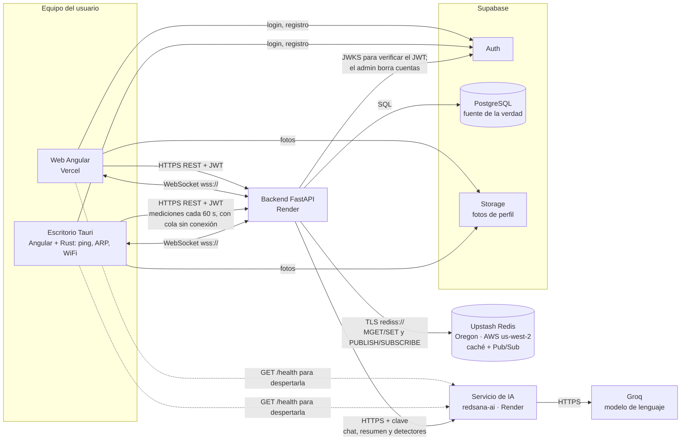
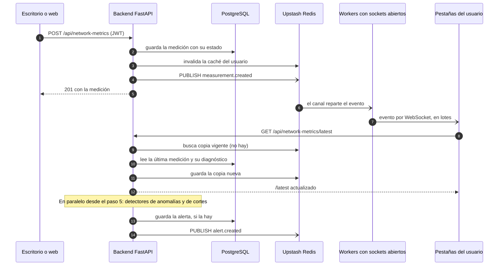

# 📡 RedSana

> **Diagnóstico inteligente de salud y seguridad para tu red WiFi doméstica.**

RedSana es una aplicación web (instalable como PWA) y de escritorio que mide tu conexión a internet cada minuto (la web, mientras está abierta; la de escritorio, también con la ventana cerrada, desde la bandeja del sistema) y te dice, en palabras simples, qué está pasando cuando algo anda mal, sin necesitar conocimientos técnicos.

**Web:** [www.app-redsana.com](https://www.app-redsana.com) (`app-redsana.com` y `red-sana.vercel.app` redirigen ahí con 308, conservando la ruta; la de `red-sana.vercel.app` está en `vercel.json`, limitada a ese host). **Escritorio (Windows):** [instalador en Releases](https://github.com/solartedaniers/redsana-frontend/releases/latest).

---

## 🔗 Repositorios del proyecto

| Repositorio                                                                   | Qué contiene                                                                                                                                                           |
| ----------------------------------------------------------------------------- | ---------------------------------------------------------------------------------------------------------------------------------------------------------------------- |
| [redsana-frontend](https://github.com/solartedaniers/redsana-frontend) (este) | App Angular (web en [www.app-redsana.com](https://www.app-redsana.com), publicada en Vercel) y capa nativa Tauri/Rust (instalador de escritorio publicado en Releases) |
| [redsana-backend](https://github.com/solartedaniers/redsana-backend)          | API FastAPI, base de datos (SQLAlchemy + Alembic) y orquestación de la IA; desplegada en Render                                                                        |
| [redsana-ai](https://github.com/solartedaniers/redsana-ai)                    | Paquete Python `redsana-ai`: asistente de seguridad (Groq), detección de anomalías (IsolationForest) y de cortes                                                       |

---

## 📑 Tabla de contenido

- [🧠 ¿Qué es RedSana?](#-qué-es-redsana)
- [🛠️ Tecnologías utilizadas](#️-tecnologías-utilizadas)
- [🤖 Inteligencia Artificial](#-inteligencia-artificial)
- [☁️ Arquitectura y despliegue](#️-arquitectura-y-despliegue)
- [⚡ Event Loop: Tasks vs Microtasks](#-event-loop-tasks-vs-microtasks)
- [🧵 Web Workers y trabajo en segundo plano](#-web-workers-y-trabajo-en-segundo-plano)
- [🖼️ Patrones de renderizado](#️-patrones-de-renderizado)
- [🧩 Patrones de diseño aplicados](#-patrones-de-diseño-aplicados)
- [🗄️ Base de datos](#️-base-de-datos)
- [🚀 Instalación y ejecución](#-instalación-y-ejecución)
- [✅ Pruebas](#-pruebas)
- [📂 Estructura del proyecto](#-estructura-del-proyecto)
- [📌 Estado actual](#-estado-actual)

---

## 🧠 ¿Qué es RedSana?

Cuando el WiFi de una casa falla, el usuario promedio no tiene forma de saber si el problema es:

- 🔌 su router,
- 📱 un dispositivo saturando la red, o
- 🌐 su proveedor de internet (ISP).

Y aunque quisiera revisar la seguridad de su router (¿tiene la contraseña de fábrica? ¿está bien configurado?), la mayoría de las guías están llenas de jerga técnica que nadie entiende.

**RedSana tiene dos módulos:**

### 1️⃣ Monitoreo preventivo de la red

La app mide tu conexión de verdad (latencia, jitter, pérdida de paquetes) cada minuto, **aprende cuál es el comportamiento normal de tu propia red** y te avisa cuando las mediciones se salen de ese comportamiento normal. Cuando hay un corte total (100 % de pérdida) seguido de la recuperación, registra una alerta con la duración del corte. En la app de escritorio, lo que se mide sin conexión se guarda en el equipo y se envía en orden al volver la conexión, así que el corte queda registrado con su duración real aunque el servidor no lo haya recibido en su momento. En la web solo cuentan las mediciones que llegan al servidor en el momento. La app de escritorio mide además la latencia hasta tu router y, con ella, el panel te dice en palabras simples si el problema parece estar en tu WiFi o router o en tu proveedor de internet, qué revisar antes de reiniciar el router y, si hay muchos dispositivos conectados, que posiblemente uno está usando mucha red (solo como posibilidad). Si internet se cae y el router, que respondía hace poco, deja de responder, el panel dice que el problema parece estar en el WiFi o en el router y qué revisar antes de reiniciarlo; si el router nunca responde al ping, no diagnostica. Cuando el servidor no responde (por ejemplo, con internet caído), el escritorio hace ese mismo diagnóstico en el equipo con su última medición y los umbrales que le pasó el servidor la última vez, y lo avisa («Sin conexión con el servidor: diagnóstico hecho en este equipo…»); las tarjetas siguen mostrando lo último que guardó el servidor. Si la ventana se abre durante el corte (desde la bandeja o al volver al panel desde otra pantalla), el diagnóstico aparece igual aunque todavía no haya llegado nada del servidor. La regla del equipo y la del backend se prueban contra la misma tabla de casos. La web no puede medir el router; pero si tu última medición la hizo la app de escritorio, el panel web muestra el diagnóstico que el servidor sacó de ella, con el texto del escritorio («Este equipo tarda X ms en llegar a tu router…»). Si la última medición fue de la web, no hay diagnóstico. La web mide mientras está abierta. En la app de escritorio, cerrar la ventana la deja en la bandeja del sistema (junto al reloj) y sigue midiendo cada minuto; la primera vez avisa una sola vez. Desde el icono, «Abrir» vuelve a mostrarla y «Salir» la cierra del todo. Abrirla de nuevo con la app ya en la bandeja muestra esa misma ventana, sin otra copia. En «Mi perfil», el interruptor «Iniciar RedSana con Windows» (solo escritorio, apagado por defecto) hace que la app arranque al encender el equipo, oculta en la bandeja, y empiece a medir; si al arrancar todavía no hay conexión (el WiFi tarda), reintenta la sesión sola hasta lograrla. Apagarlo borra la entrada de Windows, y desinstalar la app también.

### 2️⃣ Auditoría de seguridad guiada

Un cuestionario corto, en lenguaje simple (sin "firmware", sin "WPA3" sin explicar), que calcula un puntaje de seguridad de tu router y te da una guía priorizada de qué arreglar primero — más un asistente conversacional que responde tus preguntas puntuales sobre tu red o tu router.

**Todo esto corre con datos reales de tu red** — nada de valores simulados. **Solo la app de escritorio** se conecta de verdad a tu adaptador de red, hace ping real, escanea tu red local real y lee la configuración real de cifrado WiFi de tu sistema operativo; el navegador no permite nada de eso, así que la web mide el tiempo real de respuesta hasta el servidor.

---

## 🛠️ Tecnologías utilizadas

| Capa                              | Tecnología                                                             | ¿Para qué se usa?                                                                                                                           |
| --------------------------------- | ---------------------------------------------------------------------- | ------------------------------------------------------------------------------------------------------------------------------------------- |
| 🖥️ **Frontend**                   | Angular + TypeScript                                                   | Interfaz de usuario: dashboard, pantallas de autenticación, asistente de seguridad, panel de administración                                 |
| 📦 **Empaquetado de escritorio**  | Tauri (Rust)                                                           | Convierte el frontend web en una app de escritorio nativa real, con acceso al sistema operativo                                             |
| 🦀 **Mediciones reales de red**   | Rust (dentro de Tauri)                                                 | Ping ICMP real, escaneo ARP de dispositivos conectados, lectura del cifrado WiFi activo — nada de esto es posible desde un navegador normal |
| ⚙️ **Backend**                    | FastAPI (Python)                                                       | API que expone los datos, valida la sesión del usuario, calcula puntajes de seguridad y ejecuta la detección de anomalías                   |
| 🗄️ **Base de datos**              | Supabase (PostgreSQL)                                                  | Persistencia de usuarios, dispositivos, métricas históricas, alertas y evaluaciones de seguridad                                            |
| 🔐 **Autenticación**              | Supabase Auth                                                          | Login, registro y recuperación de contraseña reales, con JWT verificado por el backend                                                      |
| 🧠 **Detección de anomalías**     | scikit-learn (IsolationForest)                                         | Aprende el comportamiento normal de cada red y detecta degradaciones reales                                                                 |
| 💬 **Asistente conversacional**   | Groq API (modelo `openai/gpt-oss-120b`, configurable con `GROQ_MODEL`) | Responde preguntas del usuario sobre su red/router, usando datos reales como contexto                                                       |
| 🌐 **Almacenamiento de archivos** | Supabase Storage                                                       | Fotos de perfil de usuario                                                                                                                  |
| ⚡ **Tiempo real**                | WebSocket (FastAPI)                                                    | Avisa al panel de cada medición o alerta nueva sin esperar al sondeo (en la web y en la app de escritorio)                                  |
| 🧰 **Caché y mensajería**         | Upstash Redis (TLS)                                                    | Copias cortas de lecturas frecuentes y Pub/Sub entre los procesos del backend; sin Redis todo sigue funcionando con Postgres                |

---

## 🤖 Inteligencia Artificial

RedSana usa **dos motores de IA distintos**, cada uno elegido para el problema que realmente resuelve — no la misma IA para todo:

### 🔍 IsolationForest — detección de anomalías de red

|                              |                                                                                                                                                                                                                                                                                                                                                                                                                                                   |
| ---------------------------- | ------------------------------------------------------------------------------------------------------------------------------------------------------------------------------------------------------------------------------------------------------------------------------------------------------------------------------------------------------------------------------------------------------------------------------------------------- |
| **Qué hace**                 | Analiza las últimas 24 horas de mediciones (latencia, jitter, pérdida de paquetes) y detecta cuándo la conexión se sale de su comportamiento normal                                                                                                                                                                                                                                                                                               |
| **Por qué este modelo**      | Es **no supervisado** (no necesita datos etiquetados de "esto es una falla" — nadie tiene ese historial al empezar), **multivariable** (analiza las 3 métricas en conjunto, no una por una) y **liviano** (entrena en milisegundos sobre pocas filas, ideal para correr por usuario en tiempo real)                                                                                                                                               |
| **Costo**                    | 🆓 Gratis — librería open source (`scikit-learn`), corre en el servicio de IA si se está usando y, si no, dentro del propio backend con el mismo resultado; sin API externa                                                                                                                                                                                                                                                                       |
| **Cómo aprende "lo normal"** | Cada red es distinta (no es igual la latencia a las 3am que a las 8pm) — el modelo se re-entrena con la ventana de las últimas 1440 mediciones (24h) de **cada usuario individualmente**, así que aprende el patrón específico de esa casa, no un promedio genérico. La app de escritorio empieza a detectar con el día completo (1440); la web, que solo mide con la pestaña abierta, empieza con 720 (12h) y gana precisión al completar el día |

### 💬 Groq (`openai/gpt-oss-120b`) — asistente conversacional

|                         |                                                                                                                                                                                                                                                                           |
| ----------------------- | ------------------------------------------------------------------------------------------------------------------------------------------------------------------------------------------------------------------------------------------------------------------------- |
| **Qué hace**            | Responde preguntas del usuario en lenguaje natural sobre su red, la seguridad de su router, o cómo usar la app                                                                                                                                                            |
| **Por qué este modelo** | API **gratuita** con límites generosos, inferencia extremadamente rápida, y el modelo de pesos abiertos `openai/gpt-oss-120b` — no requiere entrenar nada propio                                                                                                          |
| **Alcance controlado**  | El asistente solo responde sobre 4 temas (red del usuario, seguridad del router, calidad de conexión, uso de la app) — controlado por instrucciones de sistema, no por un filtro de palabras clave. Si no tiene un dato real, lo dice explícitamente en vez de inventarlo |
| **Contexto real**       | Antes de responder, el backend le inyecta los datos reales y actuales del usuario (dispositivos conectados, alertas activas, última medición) para que las respuestas sean concretas, no genéricas                                                                        |

---

## ☁️ Arquitectura y despliegue



Desde la 0.2.1 la app de escritorio también recibe los cambios por el socket. Con la ventana en la bandeja la medición de 60 s sigue y el socket se mantiene abierto.

- **Frontend + capa nativa (Rust)**: la misma app Angular se publica como web en Vercel y como app de escritorio (vía Tauri), que se instala en la máquina del usuario junto con la capa nativa en Rust. Solo el escritorio puede medir la red _de verdad_ — un navegador no tiene ese acceso, así que la web mide la latencia al servidor.
- **Web instalable (PWA)**: la web trae manifest y service worker (`ngsw-config.json`), así que se puede instalar desde el navegador y abrir en su propia ventana: en Chrome o Edge, con el botón de instalar de la barra de direcciones (o menú → Instalar RedSana); en Android, menú → Agregar a la pantalla principal; en iPhone, Safari → Compartir → Agregar a inicio. Instalada o no, mide mientras está abierta (a diferencia de la app de escritorio, que sigue midiendo desde la bandeja).
- **Backend (FastAPI)**: desplegado en Render (plan gratuito); en desarrollo corre local con `uvicorn` en el puerto 8000. Es la pieza intermedia entre las dos apps y la base de datos en la nube: verifica el JWT de Supabase y guarda mediciones, dispositivos, alertas y evaluaciones. Render lo apaga tras un rato sin uso (ver [Arranque en frío](#-arranque-en-frío-render-plan-gratuito)).
- **Base de datos y autenticación**: viven en Supabase, en la nube — así los datos persisten entre sesiones y el panel de administración puede ver todos los usuarios desde cualquier lugar. Las dos apps usan Supabase Auth (login, registro y contraseña) y Storage (fotos de perfil) directamente; el resto de los datos pasa siempre por el backend.
- **Nombres de rutas**: el frontend usa solo los nombres actuales del backend (`/api/users/me`, `/api/chat-conversations`, `/api/alerts/recent`, `/api/admin/platform-metrics`). Los anteriores siguen vivos en el backend como alias ocultos para el instalador 0.1.5; `scripts/route-names.test.mjs` impide volver a escribirlos aquí.
- **Servicio de IA**: en producción el backend llama a [redsana-ai](https://github.com/solartedaniers/redsana-ai), desplegado aparte en Render (plan gratuito), que usa Groq para el asistente (`AI_MODE=remote` en el backend). En desarrollo el backend también puede usar la IA en su propio proceso (`AI_MODE=local`).
- **Redis (Upstash, en Oregon: AWS us-west-2)**: solo caché y mensajería; Postgres sigue siendo la fuente de la verdad. Guarda copias cortas de `/latest`, del progreso de calibración y de `/devices`, y lleva los eventos entre los procesos del backend (Pub/Sub). La conexión va cifrada (`rediss://`). Los detalles están en el [README del backend](https://github.com/solartedaniers/redsana-backend#caché-en-redis-redis_url).
- **Tiempo real (WebSocket)**: con la sesión iniciada y la pestaña visible, la web y la app de escritorio abren un socket a `/api/realtime/ws`, mandan el JWT en el primer mensaje y reciben los eventos de su cuenta. El frontend usa cuatro: medición nueva, alerta nueva, cambio del estado de la IA y cambio de dispositivos (`devices.updated`: Dispositivos vuelve a pedir la lista, salvo mientras escanea). Cada evento solo avisa; los datos se piden por el REST de siempre.

#### 🔴 En vivo o sondeo de respaldo

El panel muestra **«En vivo»** cuando el socket está conectado y **«Actualizando»** cuando no.

- **En vivo**: no se sondea. Cada `measurement.created` pide `/latest` una vez y cada `alert.created` pide `/api/alerts/recent` una vez. Al conectar o reconectar se pide todo una vez, por si algo pasó mientras no estaba.
- **Sin socket**: se vuelve al sondeo, `/latest` cada 4 s y alertas cada 10 s (`LIVE_UPDATES_CONFIG`). La app funciona igual, solo con unos segundos de retraso.
- **Reconexión**: espera 2 s y la duplica en cada fallo hasta 60 s, con algo de azar para que muchas pestañas no vuelvan a la vez. Vuelve a la espera inicial solo tras 30 s seguidos en vivo, así una conexión que se cae enseguida no genera un bucle. Si el servidor avisa que la cuenta está suspendida (4403) no reintenta, y un token vencido (4401) reconecta con el token vigente sin cerrar la sesión.
- **Pestaña oculta**: se cierra el socket y no se sondea; al volver se pide todo una vez.
- **Admin mirando otro hogar**: los eventos son de la red propia, así que esa vista sondea cada 4 s mientras está visible.

#### 🧯 Si Redis falla

La API sigue funcionando con Postgres:

- **Caché**: la lectura va directo a Postgres. Tras un fallo, cada proceso del backend deja de intentar Redis durante 30 s, así que solo una de sus peticiones paga la espera.
- **Socket**: si el backend no logra suscribirse al canal, cierra el socket con 1013 y el cliente sigue con el sondeo de respaldo mientras reintenta.
- **Escrituras**: guardar una medición, una alerta o un escaneo no depende de Redis. Si publicar el evento falla, el dato queda guardado igual. Si Redis cayó, los sockets se cierran y el sondeo lo trae. Si fue un fallo aislado con el socket en vivo, aparece con el siguiente evento o la siguiente reconexión.
- **Reintentos del backend**: la espera entre intentos de suscripción se duplica hasta 5 minutos. Sin sockets abiertos no se suscribe ni gasta comandos.

#### 🔁 De la medición a la pantalla



1. **Medir.** Cada 60 s el escritorio hace ping real con Rust (a internet y al router) y la web mide cuánto tarda en llegar al servidor (en un Web Worker). La web solo mide con la página abierta. El escritorio sigue midiendo desde la bandeja y, sin conexión, guarda la medición en el equipo y la envía después en orden con su hora original.
2. **Guardar.** El backend verifica el JWT, calcula el estado (bueno, advertencia o crítico) con sus umbrales y guarda la medición en Postgres. Un reenvío de la cola que ya estaba guardado no se duplica ni dispara nada otra vez.
3. **Invalidar y avisar.** Después de guardar, el backend invalida la caché de ese usuario y publica `measurement.created` en Redis, sin hacer esperar al que midió.
4. **Repartir.** Cada proceso del backend que tiene sockets abiertos recibe el evento del canal y lo envía a los sockets de ese usuario y de los administradores, en lotes, cediendo el turno entre lote y lote para no frenar otras peticiones. Un cliente lento se cierra (1013) sin demorar a los demás.
5. **Mostrar.** La pestaña pide `/latest`. Como la caché se invalidó, esa primera lectura sale de Postgres y queda guardada para las siguientes. El panel se actualiza sin recargar.
6. **Detectar.** Después de responder, el backend busca anomalías (IsolationForest) y cortes en segundo plano, solo si esa es la medición más reciente. En producción usa el servicio de IA si alguien lo está usando, y si no, el mismo paquete dentro del backend. Si hay alerta, la guarda y publica `alert.created`, y el panel la muestra. Una medición que llega tarde registra el corte con su duración real, pero no avisa de una degradación que ya pasó.

Sin socket (o con Redis caído) los pasos 4 y 5 los reemplaza el sondeo: la pestaña ve la medición en los siguientes 4 s.

#### 💤 Arranque en frío (Render, plan gratuito)

Render apaga el backend y el servicio de IA tras un rato sin uso, y tardan cerca de un minuto en volver. Para que el usuario no vea errores:

- Al abrir el login, un `GET /api/health` liviano despierta el backend mientras el usuario escribe (`BackendWakeUpService`).
- Tras iniciar sesión, `AiStatusService` pide `POST /api/ai/warm-up` y consulta `GET /api/ai/status` con backoff y un tope de espera (`AI_STATUS_CONFIG`, 700 s por defecto, por encima de los 600 s del calentamiento del backend) hasta que la IA esté lista. Usa el mismo patrón de cancelación que las mediciones: al cerrar sesión o reintentar no quedan consultas vivas.
- Además, cada vez que se pide el calentamiento (sesión, abrir el chat, reintentar) `AiClientWakeUp` hace un GET silencioso (`no-cors`, 10 s de tope) al `/health` público del servicio de IA, porque un GET desde el navegador lo despierta aunque el backend no lo logre. Se activa con `AI_SERVICE_PUBLIC_URL`; sin ella no hace nada. Nunca se dispara en segundo plano.
- La barra superior muestra **"IA encendiendo… / IA lista"**; agotado el tope, **"IA no disponible"** con un botón de reintentar.
- Mientras la IA no está lista el chat del asistente queda deshabilitado con un aviso, y el resumen de una evaluación se pide en cuanto esté lista (la evaluación se guarda igual, no usa IA). Si el backend responde "encendiendo" a un mensaje, se muestra como espera y no como fallo.
- Con un backend anterior que no tiene estos endpoints (404) la IA se da por lista, así que el orden de despliegue no bloquea el chat.

#### 🚦 Umbrales del estado de la red

- El backend decide desde dónde una medición es **advertencia** o **crítica** (latencia o pérdida de paquetes; `NETWORK_STATUS_*` en su configuración) y los publica en `GET /api/network-metrics/thresholds`.
- `NetworkThresholdsService` los pide una vez al iniciar o restaurar la sesión; el gráfico de historial clasifica con ellos por latencia **y** pérdida, así que coincide con el estado del dashboard.
- Si el backend está dormido, falla o es anterior (404), se usan los de respaldo de `network-thresholds.config.ts`, el único lugar del frontend con esos números. Nunca bloquea la carga.

#### 📶 Escaneo de dispositivos (app de escritorio)

- **Una sola regla** (desde 0.2.0): el escaneo al entrar y el botón "Escanear en busca de intrusos" usan `scan_present_devices` y cuentan solo a quien responde en ese momento: Windows deja por minutos en `arp -a` a un celular que ya se fue, así que cada equipo de la tabla se confirma con un ARP propio (`SendARP`, 2 intentos) y, a la vez, con un ping directo, que un celular dormido sí contesta aunque ignore el ARP. Un equipo que no responde a nada baja del conteo en ese mismo escaneo. Envía `manual: true` a `POST /api/devices/sync`.
- **Al entrar a Dispositivos** se muestra enseguida la lista guardada y el escaneo corre en segundo plano, con el indicador «Escaneando la red...» en el botón y el radar. Si hubo un escaneo hace menos de `LAN_SCAN_CONFIG.recentScanWindowMs` (2 min) no se repite. El botón siempre fuerza uno nuevo, aunque haya otro en curso, y el resultado del anterior se descarta. Una lista guardada que llega después del escaneo no lo pisa.
- **Conectado es lo que vio el último escaneo**: el backend guarda la misma hora en todos los equipos de un sync, y la lista, el diagnóstico y la supervisión del admin cuentan solo esos. Un equipo que se fue no reaparece al volver a la pantalla.
- **Cambios desde otro lado**: con el socket en vivo, `devices.updated` vuelve a pedir la lista, salvo mientras la pantalla escanea (su propio resultado ya la trae).
- **Redes grandes**: barre hasta 4096 direcciones (un /20; si la subred es mayor, las más cercanas a este equipo) con pings y ARP en paralelo pero acotados. Con ~450 equipos el escaneo tarda unos 17 s, contando la reconfirmación (simulado con los tiempos medidos en una red universitaria de ~290 equipos, donde tardó 12–22 s). Los límites se ajustan sin recompilar con `REDSANA_LAN_SCAN_MAX_HOSTS`, `REDSANA_LAN_SCAN_PING_CONCURRENCY`, `REDSANA_LAN_SCAN_ARP_CONCURRENCY` y `REDSANA_LAN_SCAN_ARP_ATTEMPTS`.
- **Reconfirmación**: en el mismo escaneo, a los equipos de la tabla que no contestaron nada se les pregunta otra vez tras una espera corta (1,5 s, un ARP y un ping directo). Cuenta solo el que contesta ahora: un equipo apagado o desconectado tampoco contesta y baja del conteo. Se ajusta con `REDSANA_LAN_SCAN_RECHECK_PASSES` (1; `0` la apaga) y `REDSANA_LAN_SCAN_RECHECK_DELAY_MS` (1500). Al terminar se lee la tabla ARP una vez más, sin enviar nada: cuenta a los equipos que no estaban al empezar y cuyo ARP del barrido se contestó tarde. Un equipo que estaba y no contestó sigue fuera aunque Windows lo siga listando.
- **Diagnóstico de estabilidad** (solo en una red propia): `cargo test --lib presence_stability_on_this_network -- --ignored --nocapture --test-threads=1` en `src-tauri` hace 5 escaneos separados por 30 s (`REDSANA_LAN_SCAN_DIAG_RUNS`, `REDSANA_LAN_SCAN_DIAG_INTERVAL_SECONDS`) y muestra por escaneo el conteo y por equipo si contestó en la primera pasada, en la reconfirmación o no contestó. No llama al backend ni a Supabase, y en vez de IPs y MACs muestra códigos que cambian en cada ejecución.
- **Límite físico**: un celular con la radio dormida puede no contestar durante todo el escaneo, incluida la reconfirmación, y verse como desconectado hasta el siguiente. En la red universitaria medida, en un escaneo típico ~8 de ~250 equipos presentes no contestaron a tiempo.
- **Redes con aislamiento de clientes** (algunas redes públicas o de campus): la red no deja que un equipo vea a los demás, así que el escaneo solo encuentra al router y a este equipo. La pantalla lo explica con un aviso; no es un fallo de RedSana.
- **El conteo no siempre es exacto**: depende de la red y de qué equipos respondan al escaneo en ese momento. Un equipo dormido, uno que no contesta ping ni ARP o una red que aísla a sus clientes pueden hacer que se vean menos dispositivos de los que hay.
- **Ping de la medición**: el escritorio mide internet con ping a `1.1.1.1` y el router con `REDSANA_GATEWAY_PING_TIMEOUT_MS` (1000 ms por defecto) de espera. `REDSANA_PING_TARGET` cambia el destino del ping a internet; sirve, por ejemplo, para simular un corte en pruebas con una dirección que no responde (`192.0.2.1`).
- **Diagnóstico en desarrollo**: con `REDSANA_LAN_SCAN_DIAGNOSTICS=1` y `npx tauri dev`, cada escaneo manual escribe en la terminal qué decidió con cada equipo y por qué (en el instalador no existe).

---

## ⚡ Event Loop: Tasks vs Microtasks

**Sí se aplica, de forma deliberada — auditada explícitamente, no por accidente.**

| Dónde                          | Cómo                                                                                                                                                                                                                                                                                                                                                                                  |
| ------------------------------ | ------------------------------------------------------------------------------------------------------------------------------------------------------------------------------------------------------------------------------------------------------------------------------------------------------------------------------------------------------------------------------------- |
| 🐍 **Backend (FastAPI)**       | La detección de anomalías (`IsolationForest`) tarda ~230ms en entrenar. Ejecutarla de forma síncrona dentro de la respuesta HTTP habría hecho que cada medición se sintiera lenta (~400ms en vez de ~160ms). Se usa **`BackgroundTasks`** de FastAPI: la respuesta al usuario se envía primero, y la evaluación pesada corre después, en segundo plano, sin bloquear al cliente.      |
| 🅰️ **Frontend (Angular/RxJS)** | Todas las llamadas HTTP y las promesas de Tauri (`invoke()`) se resuelven vía la **cola de microtasks** de JavaScript (`Promise`/`async-await`), nunca de forma bloqueante. La medición de red cada 60 s y el sondeo de respaldo (`/latest` y alertas, solo cuando el socket no está en vivo) usan `interval()` de RxJS con `exhaustMap()` o `switchMap()`, que no apilan peticiones. |
| 🦀 **Capa nativa (Rust)**      | El trabajo realmente pesado — ping ICMP, barrido ARP de toda la red local — nunca toca el hilo de JavaScript: corre en el proceso Rust, fuera del hilo de la interfaz por completo.                                                                                                                                                                                                   |

**Regla aplicada:** las microtasks (promesas, resultados de red) siempre se procesan antes que cualquier tarea nueva encolada — es el comportamiento nativo de JS que el proyecto respeta usando `async/await` y observables correctamente, sin trucos que lo rompan.

---

## 🧵 Web Workers y trabajo en segundo plano

**La web usa un Web Worker para medir la latencia; el resto del trabajo pesado vive fuera de JavaScript.**

En la web, la medición de latencia (peticiones `fetch` cronometradas al servidor) corre en un Web Worker (`latency-probe.worker.ts`), para que una pausa del hilo principal no se sume al tiempo medido; si el navegador no tiene Workers, la misma medición corre en el hilo principal. El resto del trabajo pesado no corre en JavaScript:

| Tarea pesada                              | Dónde corre en su lugar                                   |
| ----------------------------------------- | --------------------------------------------------------- |
| Medición de latencia de la web            | 🧵 Web Worker (`latency-probe.worker.ts`)                 |
| Ping ICMP real, escaneo ARP de la red     | 🦀 Rust (proceso nativo separado del hilo de la UI)       |
| Detección de anomalías (IsolationForest)  | 🐍 Backend Python, en segundo plano vía `BackgroundTasks` |
| Lectura de configuración WiFi del sistema | 🦀 Rust                                                   |

Es decir: **el patrón de "sacar el trabajo del hilo principal" se aplica en todo el proyecto**, con el mecanismo que corresponde a cada caso: un Web Worker para la medición de la web, Rust nativo para lo que necesita el sistema operativo (un Worker del navegador no puede hacer ping real ni leer el sistema operativo) y tareas en segundo plano del backend para el modelo de ML.

---

## 🖼️ Patrones de renderizado

**Uso dos patrones, cada uno donde tiene sentido, y descarto los demás por una razón concreta.**

| Patrón                                   | Dónde lo uso                                                                                       | Por qué                                                                                                                                                                                                                                                                                                                                                                |
| ---------------------------------------- | -------------------------------------------------------------------------------------------------- | ---------------------------------------------------------------------------------------------------------------------------------------------------------------------------------------------------------------------------------------------------------------------------------------------------------------------------------------------------------------------- |
| 🧭 **CSR** (render en el cliente)        | Toda la app: login, registro, dashboard, asistente, alertas, dispositivos, administración y perfil | Son datos privados de cada usuario que llegan del backend después de iniciar sesión. Prerenderizarlos no aporta nada: no hay nada que indexar ni que compartir, y el HTML sería distinto para cada persona. Vercel sirve `index.csr.html` para cualquier ruta que no sea un archivo (`vercel.json`).                                                                   |
| 📄 **SSG** (prerender en el build)       | Solo la landing (`/`), en `app.routes.server.ts`                                                   | Es pública e igual para todos. Al prerenderizarla, el HTML llega con el contenido, el título, la descripción, la URL canónica y las etiquetas Open Graph y Twitter Card, así que los buscadores y las vistas previas de redes la leen sin ejecutar JavaScript.                                                                                                         |
| 💧 **Hidratación** (complemento del SSG) | La landing, con `provideClientHydration`                                                           | El navegador reutiliza el HTML prerenderizado en vez de borrarlo y volver a pintarlo, así que no hay parpadeo y el fondo 3D no se reconstruye. La activo sin la caché de transferencia HTTP: el cliente pide el diccionario igual que antes, y nada del build queda congelado en el HTML. En las rutas CSR no hay datos de hidratación y Angular simplemente la salta. |

**Lo que no aplica, y por qué:**

- **SSR** (render en el servidor por petición): necesitaría un servidor Node vivo. La web se publica en Vercel como archivos estáticos (`outputMode: static`) y la app de escritorio carga esos mismos archivos dentro de Tauri, sin servidor. Además, las pantallas que cambian por usuario son privadas: renderizarlas en el servidor no mejora el SEO y obligaría a manejar la sesión allí.
- **ISR** (regenerar páginas estáticas cada cierto tiempo): solo existe con un servidor o con funciones de la plataforma que regeneren el HTML. La landing cambia únicamente cuando cambia el código, y cada despliegue ya la vuelve a prerenderizar.
- **Streaming** (enviar el HTML por partes mientras se genera): es una optimización del SSR, así que sin SSR no hay nada que transmitir. Un archivo estático ya llega completo desde la CDN.

**Detalles que cuido:**

- **Escritorio (Tauri)**: carga el `index.html` prerenderizado, pero ahí la landing no existe (`webOnlyGuard`): con sesión guardada la app abre directo en el panel de su rol y, sin sesión, en el login (`sessionHomeRedirect`). Mientras restaura la sesión, o si no hay conexión, muestra la espera o el fallo en vez del login. Por eso desactivo la hidratación cuando `isTauri()` es verdadero: el escritorio se comporta exactamente como antes.
- **Navegador**: todo lo que toca `window`, `document` o WebGL corre en `afterNextRender` o detrás de `isPlatformBrowser` (por ejemplo el fondo de Three.js y el tema), así que el prerender no lo ejecuta.
- **Buscadores**: `DocumentMetadataService` pone `index, follow` y la URL canónica solo en la landing; el resto de las rutas lleva `noindex`. `robots.txt` y `sitemap.xml` se generan en cada build (`scripts/generate-seo-files.mjs`) con el dominio de `WEB_APP_URL` y los segmentos de `app-paths.ts`, así que cambiar de dominio es cambiar esa variable. `robots.txt` cierra el rastreo de `/user/`, `/admin/` y `/account/`; `/auth/` queda abierta a propósito, porque un buscador solo respeta el `noindex` del login si puede entrar a leerlo.
- **Service worker**: usa `navigationRequestStrategy: "freshness"`. Con la estrategia por defecto respondía toda navegación con `index.csr.html` desde su caché, y quien volvía a `/` recibía la landing sin prerender. Ahora la navegación va primero a la red y, sin conexión, cae en la copia guardada.

---

## 🧩 Patrones de diseño aplicados

| Patrón                               | Dónde se usa                                                                                                                                                                                                                                          | Para qué                                                                                                                         |
| ------------------------------------ | ----------------------------------------------------------------------------------------------------------------------------------------------------------------------------------------------------------------------------------------------------- | -------------------------------------------------------------------------------------------------------------------------------- |
| 🗃️ **Repository**                    | Cada dominio (usuarios, dispositivos, métricas, alertas, evaluaciones de seguridad) tiene una clase abstracta + una implementación concreta, tanto en frontend (`*.repository.ts`) como en backend (`*_repository.py` + `*_sqlalchemy_repository.py`) | Aísla la lógica de negocio de cómo se guardan/leen los datos — se puede cambiar de fuente de datos sin tocar el resto del código |
| 🔌 **Inversión de dependencia (DI)** | Angular (`inject()`, providers) y FastAPI (`Depends()`)                                                                                                                                                                                               | Cada clase recibe sus dependencias desde afuera, nunca las crea ella misma — facilita testing y cambios                          |
| 🚪 **Gateway**                       | `NetworkMeasurementGateway`, `WifiEncryptionGateway`, `LanScanGateway`, `AvatarStorageGateway`                                                                                                                                                        | Aísla la comunicación con sistemas externos (Rust/Tauri, Supabase Storage) detrás de una interfaz simple                         |
| 🧱 **Arquitectura en capas**         | Backend: `router → service → repository`. Frontend: `componente → repository → gateway/HTTP`                                                                                                                                                          | Cada capa tiene una única responsabilidad; los routers nunca hablan directo con la base de datos                                 |
| 🧮 **Funciones de dominio puras**    | Cálculo de puntaje de seguridad, clasificación de anomalías, detección de cortes                                                                                                                                                                      | Lógica de negocio separada de la infraestructura (sin I/O), fácil de testear con datos sintéticos                                |
| 🧍 **Responsabilidad única**         | Cada clase hace una sola cosa (ej. un servicio nunca mezcla acceso a datos con lógica de presentación)                                                                                                                                                | Código mantenible y fácil de extender sin romper otras partes                                                                    |

---

## 🗄️ Base de datos

**Motor:** PostgreSQL, alojado y gestionado por **Supabase**.

### Tablas principales

| Tabla                                  | Contenido                                                                                                  |
| -------------------------------------- | ---------------------------------------------------------------------------------------------------------- |
| `users`                                | Perfil propio del usuario (su `id` es el mismo UUID que genera Supabase Auth — no se duplica la identidad) |
| `roles`                                | `standard` / `admin`                                                                                       |
| `devices`                              | Dispositivos detectados en la red del usuario (MAC, IP, confianza, última vez visto)                       |
| `network_metric_snapshots`             | Historial de mediciones reales (latencia, jitter, pérdida de paquetes) cada 60 segundos                    |
| `alerts`                               | Alertas generadas automáticamente (anomalías detectadas, cortes de conexión) o manualmente                 |
| `security_assessments`                 | Respuestas y puntaje del cuestionario de seguridad de cada usuario                                         |
| `chat_conversations` / `chat_messages` | Historial de conversaciones con el asistente                                                               |

### Decisiones de diseño relevantes

- 🔗 Cada tabla de datos del usuario tiene `owner_id` con `ON DELETE CASCADE` — al borrar un usuario, se borra todo su historial automáticamente.
- 🕐 Todas las columnas de fecha son `timestamptz` (con zona horaria explícita), para que la hora se muestre correctamente sin importar dónde esté el usuario.
- 🚦 Los estados (confianza de dispositivo, severidad de alerta, estado de red) usan `ENUM` nativo de Postgres — no strings sueltos, evita datos inválidos a nivel de base de datos.

Las migraciones se gestionan con **Alembic**.

---

## 🚀 Instalación y ejecución

Este repositorio contiene solo el **frontend**: la app Angular (web) y su capa nativa en Rust (Tauri, escritorio). Para usarla de punta a punta necesitas también la API:

- [redsana-backend](https://github.com/solartedaniers/redsana-backend): API FastAPI y base de datos. Su README explica cómo levantarla en local.
- [redsana-ai](https://github.com/solartedaniers/redsana-ai): paquete de IA que el backend instala solo; no hace falta clonarlo para correr la app.

### Requisitos previos

- 🟢 Node.js 18+
- 🦀 Rust + Cargo (para compilar la capa nativa de Tauri) — instalable desde [rustup.rs](https://rustup.rs)
- 🪟 En Windows: Microsoft C++ Build Tools (necesarios para compilar Rust)
- ☁️ Un proyecto de [Supabase](https://supabase.com) (el mismo que usa el backend)
- 🐍 La API de [redsana-backend](https://github.com/solartedaniers/redsana-backend) corriendo en local o desplegada

### 1️⃣ Configuración

```bash
npm ci

# Variables de entorno: URL y anon key de Supabase, URL de la API, URL web y enlace del instalador de escritorio
cp .env.example .env
# Editar .env (cada variable está documentada en .env.example)
```

`scripts/generate-environment.mjs` convierte esas variables en `src/environments/environment.ts` (ignorado por git). Se ejecuta solo antes de `npm run build` y de `npm test`; en Vercel las variables se definen en el panel del proyecto.

#### 🎓 Credenciales de ejemplo en el login (requisito académico)

Para la revisión del proyecto, el login puede mostrar precargados un correo y una contraseña de ejemplo, con un aviso (en español e inglés) de que son credenciales de prueba. **No es seguro**: con el interruptor encendido esos valores quedan dentro del JavaScript publicado, así que solo deben ser los de una cuenta de demostración. Nunca se escriben en el código: llegan por variables de entorno.

| Variable              | Valor                                                                     |
| --------------------- | ------------------------------------------------------------------------- |
| `DEMO_LOGIN_ENABLED`  | `true` para precargarlas; cualquier otro valor (o no definirla) las apaga |
| `DEMO_LOGIN_EMAIL`    | Correo de la cuenta de demostración                                       |
| `DEMO_LOGIN_PASSWORD` | Contraseña de esa cuenta (se usa tal cual, sin recortar caracteres)       |

Con el interruptor encendido el build falla si falta el correo o la contraseña. La validación, el medidor de contraseña y "¿Olvidaste tu contraseña?" funcionan igual con los campos precargados.

**Para desactivarlo:** en Vercel (Project Settings → Environment Variables) pon `DEMO_LOGIN_ENABLED=false` o borra la variable, y vuelve a desplegar. Con el interruptor apagado el build no escribe el correo ni la contraseña en `environment.ts` aunque sigan definidos. Para no dejarlos ni en el panel, borra también `DEMO_LOGIN_EMAIL` y `DEMO_LOGIN_PASSWORD`. Si la contraseña de demostración llegó a publicarse, cámbiala en Supabase.

#### 🎨 Logo e iconos

Todos los iconos salen de las dos fuentes de `branding/`, derivadas del logo de RedSana: `redsana-symbol.png` (símbolo completo) y `redsana-symbol-compact.png` (solo el escudo, sin los anillos, que se lee mejor en tamaños chicos). El PNG original con el texto no se guarda en el repo.

```bash
python branding/generate_icons.py   # requiere Pillow (pip install pillow); usa el CLI de Tauri ya instalado
```

El script genera los PNG de la PWA (normales y maskable), `apple-touch-icon`, `favicon.ico` (16, 32, 48), la marca de la barra superior y el login (solo el escudo, sin fondo: la luminancia del dorado pasa a ser transparencia y la app lo pinta con el token `--color-brand-symbol`, dorado en el tema oscuro y más oscuro en el claro), y el set de Tauri (`.ico` de 16 a 256, `.icns` y logos de Windows). Hasta 48 px usa el escudo compacto. Tamaños, rutas y el fondo de los iconos están en `branding/brand.json`. El color del manifest y del `<meta theme-color>` lo toma del token `--color-bg-app` del tema oscuro; `npm test` falla si dejan de coincidir o si la marca que carga la app no es la generada o deja de tener transparencia.

### 2️⃣ Desarrollo

```bash
npm start           # solo web, en http://localhost:4200
npx tauri dev       # app de escritorio con recarga en caliente
```

### 3️⃣ Compilar la app para distribución

```bash
npx tauri build
```

Esto genera el instalador nativo (`.exe`/`.msi` en Windows, `.dmg` en macOS, `.deb`/`.AppImage` en Linux) dentro de `src-tauri/target/release/bundle/`. El instalador de Windows (`*-setup.exe`) se publica en los Releases de este repositorio.

#### 🔒 CSP de la app de escritorio

`src-tauri/tauri.conf.json` define la Content Security Policy del escritorio. Solo permite:

- los archivos de la propia app (scripts, estilos, fuentes, imágenes y el Web Worker de la medición);
- la IPC de Tauri (`ipc:` / `http://ipc.localhost`);
- conexiones a la API (`https://` y su socket `wss://`: una fuente `https://` no habilita `wss://`), a Supabase (autenticación y Storage) y al `/health` de la IA;
- imágenes de Supabase Storage (fotos de perfil) y `data:` (la textura de fondo del CSS).

No usa `'unsafe-inline'` ni `'unsafe-eval'`. Tauri agrega un nonce a sus propios scripts y estilos; el `ngCspNonce` de `src/index.html` hace que Angular ponga ese mismo nonce en los `<style>` de sus componentes. Por eso ningún HTML de la app debe llevar atributos `style="…"` fijos: se usan clases o enlaces `[style.x]`. Con `npx tauri dev` la CSP no se aplica.

Si cambias la URL de la API, de Supabase o de la IA en `.env`, agrégala también a la CSP. `tauri build` falla (`scripts/prepare-desktop-build.mjs`) si falta alguna, para que no salga un instalador que no puede conectarse. Ese mismo script deja el `index.html` del escritorio igual a `index.csr.html`: Tauri lo sirve al recargar (F5) en cualquier ruta, y la landing prerenderizada traería atributos `style` del SSR que la CSP bloquea (el escritorio no hidrata, así que no la necesita).

#### 📦 Publicar una versión

Cada Release lleva **dos copias idénticas** del instalador de Windows:

- `RedSana_<versión>_x64-setup.exe`, el nombre que genera Tauri;
- `RedSana_x64-setup.exe`, con **nombre fijo**.

El botón «Descargar» de la web es un enlace normal a `DESKTOP_DOWNLOAD_URL` = `https://github.com/solartedaniers/redsana-frontend/releases/latest/download/RedSana_x64-setup.exe`. GitHub redirige esa URL al asset con ese nombre del último Release, así que la descarga empieza desde el HTML prerenderizado, aunque se pulse antes de que cargue Angular o sin JavaScript, y sin consultar la API de GitHub. **Si un Release sale sin el asset de nombre fijo, el botón da 404.** Al publicar, sube las dos copias y comprueba que tienen el mismo SHA-256. El build falla si `DESKTOP_DOWNLOAD_URL` no termina en `.exe`, para que no vuelva a apuntar a la página del Release.

**Antes de anunciar un Release, comprueba la descarga pública** en un equipo con Windows Defender al día:

1. Descarga las dos copias desde el Release publicado (no desde la carpeta del build), con el navegador, para que lleven la marca de descarga de Internet.
2. `Get-FileHash .\RedSana_<versión>_x64-setup.exe, .\RedSana_x64-setup.exe -Algorithm SHA256`: los dos SHA-256 deben ser iguales al del build.
3. `Get-Content .\RedSana_x64-setup.exe -Stream Zone.Identifier` debe mostrar `ZoneId=3` (vino de Internet; es lo que hace aparecer SmartScreen).
4. `& "$env:ProgramFiles\Windows Defender\MpCmdRun.exe" -Scan -ScanType 3 -File "$PWD\RedSana_x64-setup.exe"` y después `Get-MpThreatDetection`: no debe aparecer ninguna detección nueva con ese archivo.
5. Al abrirlo, SmartScreen puede mostrar «Windows protegió su PC» porque el instalador no está firmado: es esperado (ver [Instalar](#4️⃣-instalar-la-app-de-escritorio-windows)). Una detección de Defender, en cambio, no lo es: deja el Release como borrador y envía el archivo como falso positivo en el [portal de Microsoft](https://www.microsoft.com/wdsi/filesubmission).

### 4️⃣ Instalar la app de escritorio (Windows)

Descarga `RedSana_0.2.2_x64-setup.exe` desde [Releases](https://github.com/solartedaniers/redsana-frontend/releases/latest) (o con el botón de descarga de la web, que baja la copia `RedSana_x64-setup.exe`, idéntica). Para comprobar que el archivo es el publicado, compara su SHA-256 en PowerShell:

```powershell
Get-FileHash .\RedSana_0.2.2_x64-setup.exe -Algorithm SHA256
# Debe dar: 22E2ED714433257B6C0E408E28273DEC17A5322C50589DDA626994CF76F3F470
```

La 0.2.1 trae la CSP de la app de escritorio ([más arriba](#-csp-de-la-app-de-escritorio)).

El instalador no está firmado con un certificado de código, así que Windows SmartScreen puede mostrar «Windows protegió su PC». Para instalarlo, pulsa **Más información → Ejecutar de todas formas**. Instalarlo encima de una versión anterior la actualiza y conserva la sesión iniciada.

---

## ✅ Pruebas

| Componente                   | Comando      | Desde         |
| ---------------------------- | ------------ | ------------- |
| 🅰️ Frontend (Angular/Vitest) | `npm test`   | raíz del repo |
| 🦀 Capa nativa (Rust)        | `cargo test` | `src-tauri/`  |

Las pruebas del backend y de la IA viven en sus propios repositorios ([redsana-backend](https://github.com/solartedaniers/redsana-backend), [redsana-ai](https://github.com/solartedaniers/redsana-ai)).

---

## 📂 Estructura del proyecto

```
redsana-frontend/
├── src/
│   ├── app/
│   │   ├── core/           # Servicios, repositorios, modelos, autenticación
│   │   ├── features/       # Pantallas (auth, usuario, admin)
│   │   ├── layouts/        # Estructura visual compartida
│   │   └── shared/         # Componentes reutilizables
│   └── environments/       # environment.ts generado desde .env (ignorado por git)
├── src-tauri/              # Capa nativa en Rust
│   └── src/
│       ├── ping.rs         # Medición ICMP real (internet y router)
│       ├── lan_scan.rs     # Escaneo ARP de dispositivos
│       ├── router_ports.rs # Puertos de riesgo del router
│       ├── tray.rs         # Bandeja del sistema (cerrar = ocultar, Abrir / Salir)
│       ├── autostart.rs    # Inicio con Windows (apagado por defecto)
│       └── wifi.rs         # Detección de cifrado WiFi
├── public/                 # Íconos, manifest e i18n (assets/i18n/es.json, en.json)
├── scripts/                # Generación de environment.ts y de la tabla de fabricantes
├── .env.example
└── vercel.json
```

---

## 📌 Estado actual

RedSana está funcionalmente completo con datos 100% reales (no simulados) en todos sus módulos:

- ✅ Autenticación real (Supabase Auth)
- ✅ Escaneo real de dispositivos en la red local (Rust + ARP)
- ✅ Medición real de latencia/jitter/pérdida de paquetes (Rust + ICMP)
- ✅ Detección automática de anomalías (IsolationForest) y cortes de conexión
- ✅ Cuestionario de seguridad con puntaje real y recomendaciones
- ✅ Asistente conversacional con contexto real del usuario (Groq)
- ✅ Panel de administración con supervisión de todos los hogares registrados
- ✅ Perfil de usuario con foto y datos editables

---

<p align="center">
  Realizado por Daniers Solarte — Universidad Cooperativa de Colombia · Ingeniería de Software
</p>
